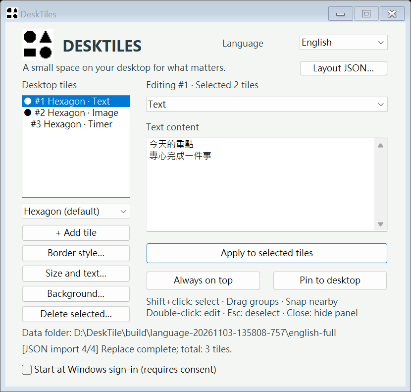
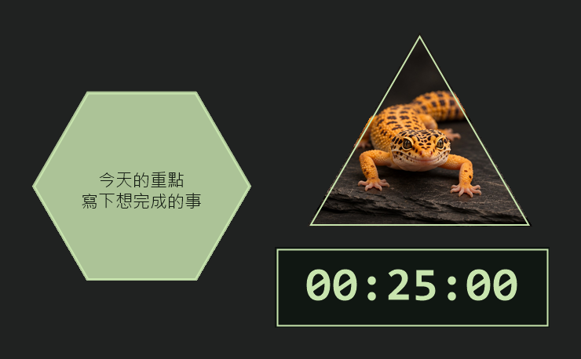

# DeskTiles

**English** · [繁體中文](README.zh-TW.md)

DeskTiles puts notes, images, and timers into draggable hexagons, triangles, and rectangles on your desktop. Arrange tiles with snapping, keep them on the desktop or above other windows, and customize their borders, backgrounds, and typography.

## Downloads

| Platform | Version | Download |
| --- | --- | --- |
| Windows 10 / 11 x64 | v1.06 | [Portable ZIP](https://raw.githubusercontent.com/NicoaTheSix/DeskTile/v1.06/release/DeskTiles-Windows-x64.zip) · [DeskTiles.exe only](https://raw.githubusercontent.com/NicoaTheSix/DeskTile/v1.06/release/DeskTiles/DeskTiles.exe) |
| macOS 12+ (Apple silicon / Intel) | v1.02 | [Universal 2 ZIP](https://raw.githubusercontent.com/NicoaTheSix/DeskTile/v1.02/DeskTile_mac/release/DeskTiles-macOS-universal.zip) |

**Windows:** Extract the complete ZIP and open `DeskTiles.exe`. Use the ZIP if you want `desktiles-cli.exe`, the guides, and the example layout. The portable app needs no installer, administrator rights, or separate runtime. To update, choose **Save and exit DeskTiles** from the tray before opening the replacement. Closing the control panel keeps the app running.

**macOS:** Extract the ZIP and open `DeskTiles.app`. The build is ad-hoc signed and has not been notarized by Apple. See the [macOS guide and platform limitations](DeskTile_mac/README.md). The Mac build does not have Windows alarms, named desktop layouts, or the Windows CLI.

[Windows user guide](docs/UserGuide.en.md) · [繁中使用說明](docs/使用說明.md) · [Project page and demo](https://nicoathesix.github.io/MyPortfolio/desktiles/)

## Using DeskTiles on Windows

| To… | Do this |
| --- | --- |
| Add a tile | Choose a shape in the control panel and select **Add tile**. |
| Move a group | Shift-click to select multiple tiles, then drag one of them. Tiles snap near neighboring edges and keep their relative positions. |
| Change content | Select a tile, choose text, image, timer, or alarm, then apply the changes. |
| Change appearance | Use the size and text, border, or background controls. Style changes can apply to a selection. |
| Change the display layer | Use the tile menu or control panel to choose desktop or always-on-top. |
| Back up a layout | Use the JSON menu to export the current layout with embedded images. Import can replace or merge the current layout. |
| Find missing tiles | Use the tray command to move them back to the primary display. |

Switch between English and Traditional Chinese using the **Language** menu. Your choice is saved. Double-click a tile or open DeskTiles from the tray to bring the control panel back.



### Named desktop layouts

Right-click the tray icon and open **Desktop layouts** to save a copy, create an empty layout, rename the current layout, or switch to a saved layout. The checked layout is visible and is restored the next time DeskTiles starts.

Switching changes which tiles appear. Timers and alarms in other layouts keep running while DeskTiles is open, and reminders include the layout name. A saved copy pauses its timers and disables its alarms so it does not create a second set of reminders.

### Command line

Start `DeskTiles.exe` first. Run the examples below in PowerShell from the extracted folder. In CMD, omit the `.\` prefix.

```powershell
.\desktiles-cli.exe layout list
.\desktiles-cli.exe layout create "Work" --empty
.\desktiles-cli.exe layout switch "Work"
.\desktiles-cli.exe tile add --shape hexagon --text "Today's tasks"
.\desktiles-cli.exe tile list
.\desktiles-cli.exe tile update --id 1 --text "Done"
.\desktiles-cli.exe tile hide --id 1
.\desktiles-cli.exe tile show --id 1
.\desktiles-cli.exe tile delete --id 1
```

Use the ID returned by `tile add` or shown by `tile list`; IDs belong to a layout. Use `tile get --id ID` for the tile's content and schedule, or add `--layout NAME` to target another layout without switching. `layout create NAME` saves a copy unless you pass `--empty`. To delete a layout, first switch away from it, then use `layout delete NAME --yes`.

`--help` lists the available options. Place `--json` before the command to get a single JSON line. Successful results go to stdout; errors go to stderr. Exit codes are `0` (success), `2` (command or save error), `3` (no matching instance), and `4` (no reply). If the app was started with `--data-dir`, pass the same path before the CLI command.

### Alarms and startup

Select **Alarm** as a tile's content type, enter optional text, and open its alarm settings. Dates use `YYYY-MM-DD`; times use 24-hour `HH:MM`. Alarms can run once, daily, or on selected weekdays. The app uses local time and must be running to deliver reminders. A restart re-arms future alarms; it does not replay reminders missed while the app was closed. Timers keep their saved elapsed time and are paused after a restart.

**Start at Windows sign-in** is off by default. DeskTiles only enables it after you opt in and confirm the executable and data paths. Disable it and opt in again if you move either path.

## Data and compatibility

Windows stores data in `%LOCALAPPDATA%\HexDesk` by default. You can use a separate folder for testing or to keep a second independent instance:

```powershell
.\DeskTiles.exe --data-dir 'D:\DeskTilesData'
.\desktiles-cli.exe --data-dir 'D:\DeskTilesData' --json layout list
```

- The first named-layout save or CLI write creates `layouts.hexdesk.json` and preserves the original `layout.hexdesk`. After that, `layouts.hexdesk.json` is authoritative. `layouts.backup.json` holds the previous saved version. Up to 32 layouts and 500 tiles per layout are supported.
- DeskTiles logs its input and output paths in `session.log`. Only one instance can write to a data folder. Launching the app again for that folder brings the existing window back; `session.lock` is normal and does not need to be deleted.
- Imported images are saved under `assets/`; images chosen from elsewhere retain their original path. Export JSON if you want to back up a layout with its images. JSON export and import apply to the active layout.
- Windows exports JSON v3 and reads v1–v3. The current Mac build reads v1/v2 and exports v2, so its exports can be imported into Windows, but Windows v3 exports cannot be imported into the current Mac build.

## Build and verify

The source build requires Windows x64, PowerShell, Visual Studio with the C++ desktop workload, and the Windows SDK. The portable ZIP does not require these tools.

```powershell
# Build the GUI and CLI and run the core tests.
.\build.ps1 -OutputName DeskTiles-update.exe

# Test named layouts, native shell commands, and background reminders.
.\verify-layouts-cli.ps1

# Package the app and CLI, then test the unpacked ZIP.
.\package.ps1 -ExecutableName DeskTiles-update.exe
.\verify-package.ps1
```

The build and verification scripts print absolute input/output paths and stage progress. Tests use isolated data directories. Optional checks include `verify-language.ps1`, `verify-activation.ps1`, `verify-interaction.ps1`, `verify-features.ps1`, `verify-icons.ps1`, and `verify-package.ps1 -Composition`. Desktop composition tests require an interactive Windows desktop with Explorer; the optional Python-based tests also require their documented dependencies.

Windows v1.06 passed 235 core checks, 192 checks on the unpacked Windows package, and 38 named-layout/CLI integration checks, including a background alarm after restart.

| Path | Purpose |
| --- | --- |
| `core.hpp`, `config.hpp`, `alarm.hpp` | Tile model, geometry, saved data, JSON interchange, and alarm schedules. |
| `layouts.hpp`, `win32_layouts.hpp` | Named-layout storage, tray commands, and switching. |
| `desktiles_cli.cpp`, `win32_cli_transport.hpp`, `win32_layout_commands.hpp` | Windows console client and commands handled by the running app. |
| `win32.cpp`, `win32_features.hpp`, `localization.hpp`, `startup.hpp` | Windows UI, display layers, notifications, language, and startup. |
| `release/`, `docs/`, `assets/` | Windows downloads and checksums, guides, and shared logo assets. |
| `DeskTile_mac/` | Native AppKit implementation and Mac package. |

The Windows app uses C++17, Win32, and GDI+. Tile input regions remain interactive even with a transparent background; the desktop layer depends on Explorer. JSON uses the bundled [nlohmann/json v3.12.0](https://github.com/nlohmann/json/releases/tag/v3.12.0). A Linux build is not currently available.

## Ceramic tile borders

New tiles default to **Ceramic tile**, a static beveled border with a lit upper-left edge and shaded lower-right edge. The default is a black background with white text and a white bevel. In **Border style…**, set the border color and a width of 1–12 px, then apply to the selected tiles. Solid, pixel, RGB, and breathing are still available; saved tiles retain their existing style. The bevel follows the shape without changing its hit area or filling transparent backgrounds.

The renderer builds one inset face per edge from the tile outline, shades it by direction, then draws the existing selection markers separately. Run `./verify-bevel.ps1` after building. It prints the absolute test paths and verifies the default, the border menu, rendered pixels, saved style and preview output in an isolated `build/bevel-test-*` directory. Older app builds cannot read the new ceramic style; choose an older border style before exporting a layout for those builds.

## Sage desktop layout (Windows)



In the tray, choose **Desktop layouts → Create from Sage preset…** and enter a name. The app extracts its embedded photo into the data folder, creates a separate layout and switches to it. The previous layout and its active timers remain available. The preset contains an editable hexagonal note, a replaceable triangular photo and a paused 25-minute rectangular countdown. The app uses your existing desktop wallpaper.

Right-click a photo and choose **Adjust photo crop…** to drag its framing and set 100–400% zoom. Replacing a photo resets the framing. In **Tile size and text style…**, enable sizing to set a rectangle's width (80–480 px) and height (40–480 px). A blank height uses the original 3:2 ratio. **Hide tile ID and status labels** applies to the selected tiles. Start or pause the countdown from the tile menu or control window.

The renderer clips an aspect-fill image to the tile outline after applying the saved focus and zoom. Custom rectangles use the same dimensions for drawing, hit-testing, collisions and snap. JSON exports include the photo and presentation settings. Layouts using these settings require this Windows build.

Run `./verify-sage.ps1` after building. It prints the input and output paths and verifies layout creation, editing, persistence and countdown switching with isolated test data.

The bundled `assets/sage-gecko.jpg` is a JPEG export of a photo generated with the built-in image generation tool. The Portfolio mockup served as the visual reference.

<details>
<summary>Photo generation prompt</summary>

Create a photorealistic landscape photograph for a DeskTile demo, using the attached product mockup only as subject, palette and framing reference. A golden-orange leopard gecko with spotted markings facing the camera, its head just below the frame center at x=50%, y=60%, both front legs visible below the head on dark slate. Warm directional light, softly blurred charcoal background, realistic natural details. Keep the animal in the center half of the frame with extra margins, so it will be visible when the application masks the image into a triangle. Deliver only the complete rectangular photograph, without any text, graphics, border, triangle or UI.

</details>
