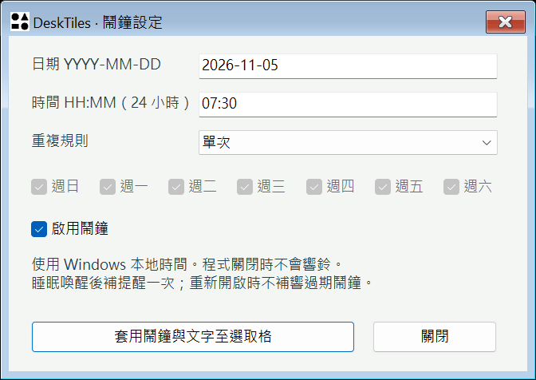
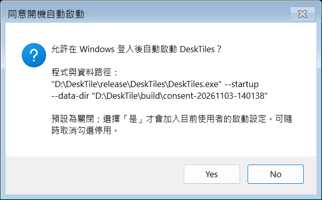
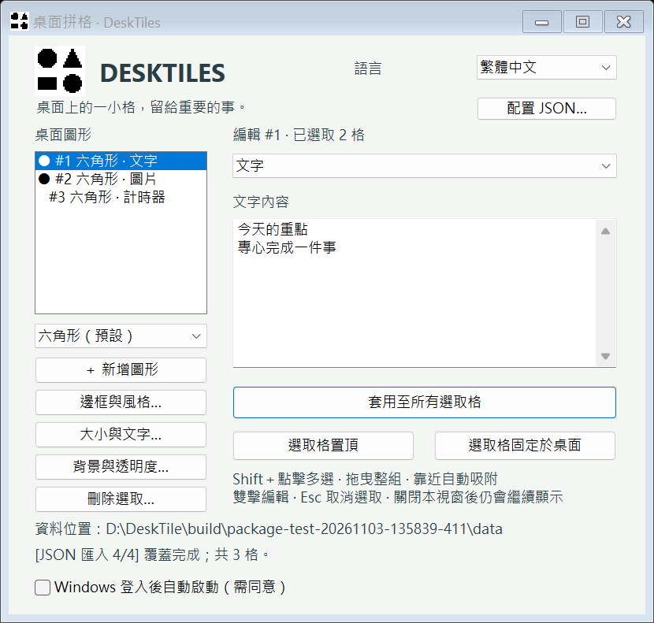
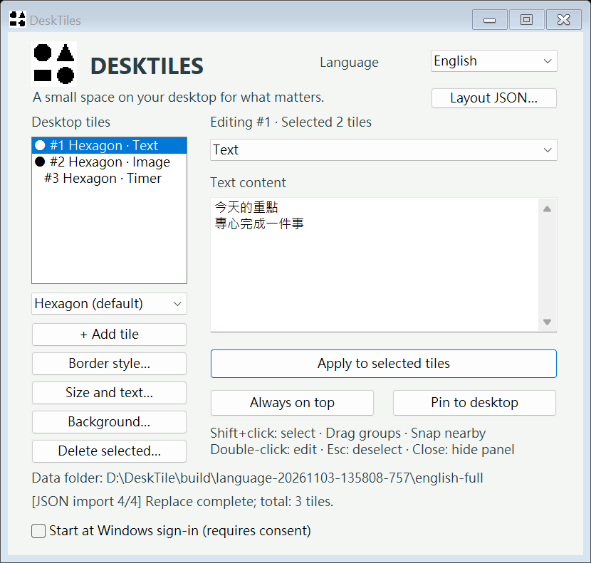
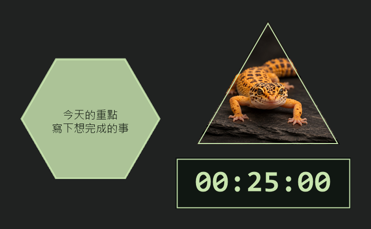

# 桌面拼格 DeskTiles

[English](README.md) · **繁體中文**

**下載：** [Windows v1.05 免安裝 ZIP](https://raw.githubusercontent.com/NicoaTheSix/DeskTile/v1.05/release/DeskTiles-Windows-x64.zip) · [僅下載 DeskTiles.exe](https://raw.githubusercontent.com/NicoaTheSix/DeskTile/v1.05/release/DeskTiles/DeskTiles.exe) · [macOS v1.02 Universal 2 ZIP](https://raw.githubusercontent.com/NicoaTheSix/DeskTile/v1.02/DeskTile_mac/release/DeskTiles-macOS-universal.zip)

Windows ZIP 同時包含命令列工具與使用說明。

專案倉庫：[NicoaTheSix/DeskTile](https://github.com/NicoaTheSix/DeskTile)。本機開發目錄為 `D:\DeskTile`；免安裝執行檔位於 `release/DeskTiles/DeskTiles.exe`。搬移不影響原本的使用者版面資料。

可在 Windows 桌面拼放六角形、三角形與矩形，顯示文字、圖片、計時器或鬧鐘。支援多選拖曳、吸附、置頂／桌面層、背景透明、像素／RGB／呼吸邊框及含圖片的 JSON 配置。

## macOS 版本

Mac 原生版位於 [DeskTile_mac](DeskTile_mac/README.md)，使用 AppKit 與原有 C++ 核心。

- [下載 Mac 版（Apple silicon／Intel）](DeskTile_mac/release/DeskTiles-macOS-universal.zip)
- [Mac 使用說明與已知差異](DeskTile_mac/README.md)

解壓後雙擊 `DeskTiles.app`；支援 macOS 12 以上。此版本採本機 ad-hoc 簽章，尚未經 Apple 公證。
已通過 170 項核心檢查及本機 Apple silicon AppKit 整合測試；Intel、多螢幕與其他 macOS 版本仍待實機驗證。

## 一般使用者從這裡開始

1. 取得 [DeskTiles-Windows-x64.zip](release/DeskTiles-Windows-x64.zip)，完整解壓縮。
2. 進入解壓後的 `DeskTiles` 資料夾，雙擊 `DeskTiles.exe`。
3. 左側選形狀並新增；右側編輯內容後按套用。

**免安裝 ZIP 解壓後即可執行。** 適用 Windows 10／11 x64，不需要安裝 Visual Studio、Python、.NET 或其他額外執行套件，也不需要管理員權限。EXE 使用靜態 C++ 執行階段，Logo 已內嵌。

**原始碼專案需要建置。** 若只下載程式原始碼而沒有使用版 EXE，請依下方開發指令建置。Linux 版尚未開發，列於後續規劃。

本機已解壓的使用版位於 `release/DeskTiles/DeskTiles.exe`。完整步驟見 [使用說明](docs/使用說明.md)，套件提供 `README.txt`、使用說明、內嵌圖片的範例配置與第三方授權。

Portfolio 網站管理員的上架資料與素材來源見 [網站上架交接](docs/網站上架交接.md)。

## 中英文操作入口

右上角選擇 **語言 → English / 繁體中文**，立即切換並記住偏好。右鍵與系統匣也提供 Language 選單；不會翻譯格子內容或清除尚未套用的編輯。英文說明見 [English user guide](docs/UserGuide.en.md)。

## 鬧鐘、計時文字與登入啟動

- 選取圖形後，內容類型選「鬧鐘」，輸入自訂文字，再開啟「鬧鐘設定…」。日期為 `YYYY-MM-DD`，時間為 24 小時 `HH:MM`；重複規則預設「單次」，可選「每天」或「指定星期」。按「套用鬧鐘與文字至選取格」後保存，也支援多選套用。單次啟用必須是未來的有效本地時間。
- 計時器與鬧鐘的同一格會一起顯示時間數字和自訂文字；在控制視窗編輯「文字內容」後套用即可。空文字仍可使用計時／鬧鐘。
- 到期使用系統提示音、系統匣通知和可關閉的非阻塞提醒視窗；通知保留文字並能在中英文間切換。系統音量或通知設定仍由 Windows 控制。
- 使用 Windows 本地時間。App 必須執行中；休眠期間到期，喚醒後補提醒一次，避免重複鬧鐘連續補響。重新啟動時過期單次鬧鐘會停用，重複鬧鐘排到下個時段；不會補響關閉期間的事件。夏令時間不存在的時段略過該日，重複時段同一天只提醒一次。
- 「Windows 登入後自動啟動（需同意）」**預設關閉**。只有使用者勾選並在顯示絕對程式／資料路徑的確認視窗選「是」，才會寫入目前使用者的 Windows 登入啟動設定；「否」為預設選項。取消勾選會移除本程式的啟動值。一般啟動、建置、打包、更新、語言切換及 JSON 匯入都不會啟用。此設定不包含在配置 JSON，測試不會替使用者開啟。
- 登入啟動沿用確認時的絕對 EXE 與資料目錄，啟動後顯示格子與系統匣，控制視窗保持隱藏。搬動程式／資料路徑後，請先取消，再於新位置重新勾選與同意；不會自行更改已同意的命令。

### 新功能程式流程與驗證

1. `alarm.hpp` 用本地日曆計算下次單次／每日／每週時段，跨夏令時間以日曆天計算，保存最後消耗的時段以避免重複。`core.hpp` 的 `HEXDESK 6` 可讀取 v1–v5，`config.hpp` 的 JSON v3 可讀取 v1–v2；鬧鐘設定、文字與圖片隨配置備份，執行中的時段快取不匯出。
2. `win32_features.hpp` 提供鬧鐘設定、提醒與登入啟動 UI；`win32.cpp` 只在有計時器或已啟用鬧鐘時使用共用 1 秒時脈。鬧鐘只比較已計算的時段，到期先保存消耗狀態，再提示；平時不重建文字快取。
3. `startup.hpp` 在沒有明確同意時拒絕啟用寫入。實際設定只操作 `HKEY_CURRENT_USER\Software\Microsoft\Windows\CurrentVersion\Run` 的 `DeskTiles` 值，不需要管理員權限。命令含引號及絕對路徑，遵守 Windows 260 字元命令上限；過長時回報失敗，不寫入不完整設定。[Windows Run 設定依據](https://learn.microsoft.com/en-us/windows/win32/setupapi/run-and-runonce-registry-keys)。
4. `verify-features.ps1` 先列出 EXE、專用配置與結果的絕對路徑，再分階段執行鬧鐘、文字像素、提醒關閉及未同意保護測試。登錄檔讀寫只測試 `Software\DeskTiles\Test-程序編號` 並清理；前後比對真實登入值，確認未改動。執行：`./verify-features.ps1 -ExecutableName DeskTiles-update.exe`。

另可用 `python -X utf8 verify-consent.py --executable 'D:\DeskTile\build\DeskTiles-update.exe'` 驗證一般啟動的確認視窗：檢查絕對路徑與預設「否」，測試只選「否」，並比對真實登入值未改動。接著建立未來鬧鐘、切英文、以 `--startup` 重新啟動，確認配置保留且控制面板隱藏；結果寫在 `build/consent-*`。此開發測試需 Python／Pillow；若使用者已有啟動值，測試會停止，保留該設定。





## 常用操作

| 要做的事 | 操作 |
| --- | --- |
| 新增 | 左側選六角形（預設）、朝上正三角形或 3:2 矩形，再按「新增圖形」 |
| 多選／移動 | Shift＋單擊多選，拖曳任一選取格移動整組；靠近其他格吸附 |
| 文字、圖片、計時器 | 選格後在右側選內容類型，設定後按套用 |
| 大小與字體 | 「大小與文字…」；寬度 80～480 px，字級 8～96 px |
| 外觀 | 「邊框與風格…」「背景與透明度…」，可多選套用 |
| 顯示層 | 右鍵或控制視窗選置頂／固定桌面 |
| 備份與搬移 | 「配置 JSON…」匯出含圖片的配置；匯入可覆蓋或合併 |
| 找回圖形 | 系統匣選「找回全部圖形」 |
| 結束 | 先套用編輯，再從右鍵／系統匣選「儲存並結束桌面拼格」 |

關閉控制視窗只會隱藏面板，圖形仍在背景運作。再次雙擊圖形或重新執行程式可帶回控制視窗。換新版之前請先儲存並結束舊版。





## 功能與範圍

- 六角形、正三角形、3:2 矩形，獨立無邊框視窗；圖形外可操作原桌面。
- 文字、PNG／JPEG／BMP 圖片、正向／倒數計時器；多選可批次套用。
- 多選保持相對位置、混合形狀碰撞檢查與 22 px 範圍吸附；重疊放置回復原位。
- 自訂尺寸、字體、字級、文字顏色；縮放造成碰撞時整批保留原設定。
- 邊框實色、像素、RGB 彩虹與指定色呼吸燈；厚度 1～12 px，動畫週期 2～60 秒。
- 背景顏色及 0～100% 透明度獨立套用。只影響背景；全透明區仍可選取和拖曳。
- 控制介面 18 px、標題 32 px，黑白圓角幾何 2×2 Logo；內容字級另行設定。
- JSON 含全版面與 Base64 圖片，支援覆蓋及合併；匯入格子的計時器預設暫停。
- 最多 500 格；JSON 128 MiB，單張圖片 16 MiB，圖片總量 64 MiB，解析度上限 6400 萬像素。

## 資料位置與啟動問題

預設資料存於 `%LOCALAPPDATA%\HexDesk`，保留舊名稱以沿用既有版面。可執行：

```powershell
.\DeskTiles.exe --data-dir 'D:\DeskTilesData'
```

啟動時會先顯示版面與日誌的絕對路徑及進度。版面為 `layout.hexdesk`，上次保存備份為 `layout.backup`；JSON 匯入另存 `import-before-*.hexdesk`。匯入的圖片存於 `assets`，使用 SHA256 命名。選自其他資料夾的圖片仍引用來源路徑，請用 JSON 一起備份。

同一資料目錄只允許一份程式寫入。重複啟動時會找到資料鎖持有者，帶回該執行個體的控制視窗；不會重設未套用的欄位或終止舊版。若確實無法寫入，會顯示資料位置及 Windows 錯誤碼。`session.lock` 留在磁碟上屬正常情況，不應靠刪除它處理啟動問題。

## 執行流程與進度

- **啟動**：解析資料位置 → 取得資料鎖或帶回既有視窗 → 顯示絕對輸入／輸出路徑 → 五階段初始化 → 載入版面與圖示 → 建立圖形、控制視窗及系統匣 → 等待操作。
- **新增**：列出輸出版面路徑 → 三階段找相鄰空間、建立圖形、保存。
- **拖曳**：按下立即切換主格並重繪選取與面板 → 擷取滑鼠、記錄整組原位置 → 超過移動門檻後產生吸附預覽 → 放開時讀取最後座標 → 檢查碰撞並提交或回復 → 保存。Shift 取消選取與雙擊開啟面板延後到原地放開；擷取中斷則取消預覽。
- **外觀／大小／背景**：顯示輸入及輸出位置 → 驗證 → 套用勾選欄位並更新快取 → 保存；各視窗顯示三階段進度。
- **保存**：寫入暫存檔 → 備份上一版 → 原子替換。損壞檔案不直接覆寫；重開後計時器暫停。
- **JSON 匯出**：顯示路徑 → 整理配置與圖片 → 驗證 → 暫存檔完成後原子替換輸出。
- **JSON 匯入**：顯示路徑 → 驗證格式、數值、重疊與圖片 → 備份 → 保存圖片及候選版面 → 重建視窗。合併保留既有 ID 與計時狀態，匯入格分配新 ID，必要時整組平移。
- **動畫與計時**：靜態內容快取重用，啟用時共用約 12 FPS 動畫或每秒計時事件；不需要時移除事件。

## 開發、驗證與打包

開發需要 Windows x64、PowerShell、Visual Studio C++ 桌面開發工具與 Windows SDK。使用版不需要這些工具。

```powershell
# 建置與 核心檢查（含鬧鐘與啟動同意保護）；另輸出更新版，避免原 EXE 使用中
.\build.ps1 -OutputName DeskTiles-update.exe

# Windows UI、損壞檔保護與獨占鎖測試
.\verify.ps1 -ExecutableName DeskTiles-update.exe

# 重複啟動應帶回隱藏視窗，原程序與版面維持不變
.\verify-activation.ps1 -ExecutableName DeskTiles-update.exe

# 語言切換、實際重新啟動、設定保護與英文完整功能
.\verify-language.ps1 -FullEnglish

# 複製執行檔與說明、建立 ZIP 和 SHA256
.\package.ps1

# 從 ZIP 解壓並直接執行，另用一般啟動驗證真實螢幕合成與置頂
.\verify-package.ps1 -Composition
```

每個腳本都先列出絕對輸入／輸出路徑，再顯示階段進度。`run.ps1` 可啟動最新建置，也可指定 `-ExecutableName`、`-DataDir`。Windows 桌面層測試需在可存取一般桌面與 Explorer 的環境執行；應用程式本身不需管理員權限。

最新結果集中於 [驗證摘要](docs/驗證摘要.txt)。測試使用專用工作目錄，不使用或打包個人版面。

## 實際畫面與顯示層的運作流程

1. 啟動時先列出 `layout.hexdesk` 和 `session.log` 的絕對輸入／輸出路徑，再依五個階段載入配置、建立視窗和顯示控制面板。
2. 每個圖形使用帶 DWM 全客戶區透明框架的普通無邊框輸入視窗；繪製時將宿主清為 alpha 0，透明子視窗用 `UpdateLayeredWindow` 呈現文字、圖片及邊框。宿主保留多邊形滑鼠命中區，完全透明處也能操作。不使用會使一般啟動畫面變黑的 `WS_EX_NOREDIRECTIONBITMAP`。
3. 桌面模式保留獨立頂層合成，以 Explorer 為 owner 並放在普通視窗下方；不再將視窗轉成 Explorer 的子視窗。置頂模式解除 owner，再以 `HWND_TOPMOST` 顯示。兩種模式的座標都用螢幕座標；桌面單擊不啟用前景視窗。
4. 內容仍使用快取，動畫共用計時器；DWM 合成重新啟用時會重設透明框架。配置格式與個人資料目錄保持相容。
5. `verify-composition.ps1` 呼叫同目錄 `verify-composition.py`，各以一般啟動方式測試保存為置頂／桌面的兩種配置；驗證實際螢幕背景、邊框、文字、圖片、前景遮擋、透明命中和拖曳。它不以記憶體畫面匯出或 `PrintWindow` 作為顯示成功的依據。

開發者可執行 `./verify-composition.ps1 -ExecutablePath 'D:\DeskTile\release\DeskTiles\DeskTiles.exe'`。測試需要互動式 Windows 桌面、Python 和 Pillow 12.3 以上；這些是開發驗證相依，免安裝 App 不需要。腳本會先列出絕對路徑和階段進度，暫時顯示桌面並於 `finally` 還原視窗；只操作專用配置，結果與圖形截圖寫入 `build/composition-*`。需避免同時操作電腦或執行其他 UI 測試，以免前景視窗干擾像素驗證。

## 專案檔案

| 位置 | 用途 |
| --- | --- |
| `release/` | 可直接使用的資料夾、ZIP 與 SHA256 |
| `alarm.hpp`、`startup.hpp` | 本地鬧鐘排程、重複規則、啟動同意與命令引號規則 |
| `win32_features.hpp` | 鬧鐘設定、非阻塞提醒與使用者明確同意的 Windows 登入啟動 |
| `core.hpp` | 跨平台模型、形狀、選取、吸附、碰撞、計時及內部保存 |
| `localization.hpp` | 繁體中文／英文詞條、語言代碼與核心錯誤翻譯 |
| `config.hpp` | JSON、Base64 圖片、驗證與合併 |
| `win32.cpp` | Windows 圖形／控制視窗、桌面層、圖示、系統匣及整合檢查 |
| `tests.cpp` | 核心檢查 |
| `DeskTiles.rc`、`HexDesk.manifest` | 內嵌圖示、一般使用者權限及 DPI 宣告 |
| `assets/` | 黑白像素來源、Logo 輸出與產生腳本 |
| `third_party/nlohmann/` | JSON 相依檔及 MIT 授權；不需建置時下載 |
| `docs/` | 使用說明、最新截圖、範例配置與驗證摘要 |
| `build/` | 最新開發執行檔及可重新產生的編譯／測試產物 |

內部格式為 `HEXDESK 6`，可讀取 v1～v5；JSON 為 `format: HexDesk`、version 3，可讀取 version 1～2。形狀值為 0 六角形／1 三角形／2 矩形。舊格式缺少形狀時還原為六角形。格子選取、控制項代碼等暫時狀態不寫入 JSON；字體以名稱保存，不打包字型檔案。

## 技術依據與後續工作

採 C++17、Win32、GDI+ 與 Windows 內建函式庫。透明顯示與六角形／三角形／矩形的互動區域分開，避免 alpha 0 區域點擊穿透。桌面層依賴 Explorer 宿主，屬相容性敏感部分。

- 重複啟動只用 [Restart Manager](https://learn.microsoft.com/en-us/windows/win32/api/restartmanager/nf-restartmanager-rmgetlist) 查詢鎖持有者，再帶回控制視窗；不呼叫關閉或重啟其他程式的 API。
- 視窗透明依據 [UpdateLayeredWindow](https://learn.microsoft.com/en-us/windows/win32/api/winuser/nf-winuser-updatelayeredwindow) 與 [extended window styles](https://learn.microsoft.com/en-us/windows/win32/winmsg/extended-window-styles)。
- JSON 使用 [nlohmann/json v3.12.0](https://github.com/nlohmann/json/releases/tag/v3.12.0)，授權隨使用版提供。
- 後續開發 Linux 顯示後端與打包；Windows EXE 不能直接作為 Linux 原生程式執行。
- 待驗收：不同 Windows 版本、DPI／多螢幕、Explorer 重啟、大量格子及長時間資源壓力。既有數字是本機短時間測試，並非所有環境的效能保證。

## Git 上傳流程

在專案根目錄檢查變更與遠端 → 確認不含個人版面、日誌與暫存檔 → 驗證腳本及套件 SHA256 → 提交原始碼、文件與使用版 → 推送至 origin/main → 比對本機與遠端提交。build/、Data/ 及 *.user 由 .gitignore 排除；使用者資料仍保存在專案外的 LocalAppData。

## 拖曳與字體回歸驗證

專用空資料目錄啟動 --interaction-test --data-dir 絕對路徑 → 顯示輸入／輸出位置 → 實際視窗訊息測試立即選取、快速放開、連按拖曳、Shift 與擷取中斷 → 檢查三形狀小尺寸／大字級的文字與計時器像素 → 還原測試版面 → 寫入 interaction-results.txt 後結束。此模式必須指定資料目錄，不能使用個人版面。

## 操作示範影片

[在作品集觀看 30 秒操作示範](https://nicoathesix.github.io/MyPortfolio/desktiles/)。

record-demo.py 是開發用錄製工具，需要 Python、Pillow 與 FFmpeg；一般使用者執行桌面拼格不需要這些工具。它先列出執行檔、專用示範版面與輸出影片的絕對路徑，再依序建立虛構資料 → 啟動獨立程式 → 重播真實 Win32 選取、拖曳與字體控制 → 僅擷取該程序視窗 → 合成 30 秒 H.264 MP4 → 比對保存位置及字體設定 → 結束自己建立的程序。每秒回報幀數進度，不擷取整個桌面；輸出為 docs/DeskTiles-fixes-demo.mp4，驗證摘要與影片同名 .txt，抽樣影格保存在 build/video-demo-*。

字體繪製流程：解析指定字體與可用樣式 → 缺少時優先使用微軟正黑體 UI → 依形狀計算內容區域 → 量測多行文字 → 必要時有限次二分搜尋縮小顯示字級 → 只繪製完整行，過長時省略 → 快取靜態內容。此流程不修改保存的字體名稱或字級。

快速檢查指令：`.\verify-interaction.ps1`。25 項拖曳／字體檢查亦納入完整 `verify.ps1`；Windows 整合總數由 123 增為 148。示範擷取使用 `--demo-capture --data-dir 絕對路徑`，只在明確啟用時輸出該專用目錄的圖形 PNG；一般啟動不啟用。

所選字體缺少內容中的中文字元時，整段內容會使用可完整顯示的中文字體替代，讓量測與繪製保持一致，避免字元重疊；原字體名稱與字級設定仍保留，純英文且受支援的內容維持選定字體。

即時選取只重繪選取狀態改變的邊框，不重建文字與圖片快取，避免每次按下都重新量測全版面的文字。

## 中英文介面切換

實作流程：建立 localization.hpp 中英文詞條 → 接入主視窗、設定視窗、選單、圖形狀態與錯誤訊息 → 語言偏好獨立保存於資料目錄 ui-settings.json → 切換前擷取尚未套用的輸入 → 更新文字及選單選項 → 還原輸入、選取與焦點 → 重繪圖形 → 驗證切換與重新啟動後的偏好。所有設定與驗證階段都顯示進度及絕對輸入／輸出位置。

語言驗證流程：專用資料目錄執行 --language-test → 實際切換全部視窗並驗證草稿與計時器 → 模擬偏好檔被鎖住時的保存失敗 → 結束後真正重新啟動確認英文 → 切回中文後再次重啟 → 損壞設定檔回復預設且保持原檔 → 選用 -FullEnglish 執行全部 Windows 功能。原生語言檢查 18 項納入完整整合測試，目前 222 項核心、192 項 Windows 整合檢查。語言切換後保留未套用狀態；只有明確按套用才更動格子設定。

Windows 系統視窗的語言偏好以 [SetThreadUILanguage](https://learn.microsoft.com/en-us/windows/win32/api/winnls/nf-winnls-setthreaduilanguage) 設定；檔案與選色對話框可用翻譯取決於 Windows 內建語言資源。

## 圓角圖示更新

本次採用 A 圓角幾何圖示，Windows 與 macOS 共用 assets/DeskTiles.svg 的四圖形設計，PNG 外角透明。詳細流程見 assets/README.md。

Windows build.ps1 先列出絕對輸入／輸出位置，以向量抗鋸齒重建多尺寸 ICO，再編譯內嵌資源、執行核心及整合檢查，最後以 package.ps1 建立免安裝 ZIP。此次沿用本機已交付的中英文、鬧鐘與啟動同意功能，不因 GitHub 舊 Windows 基底而回退；不在本次新增其他功能。

Mac build.sh 先列出絕對路徑並執行核心檢查，建立標準／Retina iconset 與 ICNS，編譯 Universal 2 App，複製圖示與 Info.plist 後重新 ad-hoc 簽章。verify.sh 檢查 ICNS 可解碼、Finder 圖示設定、雙架構、簽章與 AppKit 圖示載入，package.sh 驗證完整 App 再封裝。

GitHub 的 macOS verified package 工作流程在圖示更新分支建置與驗證，再將通過的 ZIP、ICNS 與 SHA256 提交回相同分支；下載版只有在驗證通過後才整合至 main。workflow_dispatch 亦可手動重建。App 仍未申請 Apple 公證，Intel 硬體、多螢幕與各版本 macOS 的實機驗收限制沿用原版。

Windows v1.05 已驗證重啟後的背景鬧鐘；程式關閉期間錯過的提醒不會補播。圖示更新不更動使用者版面或自動啟動設定。
Windows 正式版為 v1.05，包含多套桌面配置與 CMD／PowerShell 命令列。macOS 維持 v1.02。兩平台的 Logo 皆沿用深灰細圈與透明外角。Windows PowerShell 腳本使用 UTF-8 BOM 以支援內建 5.1。

圖示回歸：powershell -NoProfile -ExecutionPolicy Bypass -File verify-icons.ps1 -ExecutablePath <EXE絕對路徑>。腳本先列出圖示、EXE與結果絕對位置，逐尺寸檢查九個ICO的解碼、透明角落及平滑邊緣，再比對打包EXE內嵌圖示的每一個位元組並實際呼叫Windows圖示載入；結果存於build/icon-verification.txt。

平台配置限制（原始碼核對）：Windows匯出JSON v3並讀取v1–v3；Mac僅匯出/讀取v1–v2，尚不能直接匯入Windows新版v3，即使未使用鬧鐘亦然。Mac v2可由Windows匯入；本批不新增Mac v3支援。


## 多套桌面配置與命令列（Windows）

從系統匣右鍵選「桌面配置」，可以保存目前配置的副本、新增空白配置、重新命名目前配置，或直接切換。勾選項是目前顯示的配置；重新開啟 App 也會回到這一套。切換只換桌面上的方塊：其他配置的計時器與鬧鐘仍會運作，提醒會標示配置名稱。保存副本時，副本的計時器先暫停、鬧鐘先停用，避免同一提醒響兩次。

先執行同資料夾的 DeskTiles.exe，再從 CMD 或 PowerShell 執行以下指令。PowerShell 在目前目錄執行時用 `./desktiles-cli.exe`（也可用 `.\desktiles-cli.exe`）；CMD 可直接用 `desktiles-cli.exe`。

```text
desktiles-cli.exe layout list
desktiles-cli.exe layout create "工作" --empty
desktiles-cli.exe layout switch "工作"
desktiles-cli.exe tile add --shape hexagon --text "今日待辦"
desktiles-cli.exe tile list
desktiles-cli.exe tile update --id 1 --text "已完成"
desktiles-cli.exe tile hide --id 1
desktiles-cli.exe tile show --id 1
desktiles-cli.exe tile delete --id 1
```

- `tile list` 列出 ID 和目前可見狀態；`tile get --id 1` 也會顯示內容與計時／鬧鐘狀態。ID 的範圍是一套配置。
- 可用 `tile list --layout "工作"` 或在任何方塊指令加上 `--layout "工作"` 操作背景配置；不會自動切換。未指定時使用目前配置。
- `layout create NAME` 保存目前配置副本；加 `--empty` 建空配置。名稱按原字比對。用 `layout rename OLD NEW` 改名；要刪除整套配置，先切到另一套，再用 `layout delete NAME --yes`。
- `--help` 列出形狀、位置、尺寸、圖片、顯示層級、計時和鬧鐘選項。用 `--json`（放在命令前）取得單行 JSON；成功輸出到 stdout、錯誤輸出到 stderr。離開碼 0 為成功、2 為指令或儲存錯誤、3 為沒有對應的執行個體、4 為未收到回覆。
- 若 App 以 `--data-dir` 指定資料目錄，CLI 也須使用相同路徑，例如 `desktiles-cli.exe --data-dir "D:\DeskTilesData" --json layout list`。

### 儲存、排程與建置流程

1. App 先列出絕對資料路徑。沒有 `layouts.hexdesk.json` 時照常讀取舊的 `layout.hexdesk`；第一次儲存具名配置或用 CLI 寫入時，保存為資料目錄下的 `layouts.hexdesk.json` 並保留舊檔。之後具名配置檔是唯一生效的配置資料來源，儲存前備份上一份至 `layouts.backup.json`。上限為 32 套，每套 500 格。
2. 系統匣及 CLI 修改都由同一個 App 執行：準備新配置或視窗 → 備份並原子保存 → 顯示新畫面。寫入失敗保留舊配置及顯示。外部 CLI 只連到同使用者、同資料目錄的執行個體，不直接寫資料檔。CLI 對成功輸出保留乾淨 JSON；App 狀態列和 session.log 顯示路徑與進度。
3. 共用時脈同時推進所有配置；只有目前配置建立方塊視窗。個別方塊的隱藏狀態隨該套配置保存。App 完全關閉後不會提醒；重新開啟時鬧鐘重新排程，計時器保留已經過時間並維持原本的暫停規則。舊的 JSON 匯入／匯出依然只作用於目前配置，維持舊格式。
4. `build.ps1` 依序定位工具鏈、編譯 GUI、編譯 CLI、執行核心測試及核對輸出。 `verify-layouts-cli.ps1` 使用獨立資料目錄，驗證 CMD、PowerShell、系統匣、重啟、儲存回復、背景倒數及實際鬧鐘。 `package.ps1` 將 GUI 和 CLI 一起打包；驗證腳本會列出絕對輸入／輸出路徑及各階段進度。

此功能目前適用 Windows；macOS 套件尚未包含多套配置及這個 CLI。

## 鼠尾草綠桌面配置（Windows）



從系統匣選「桌面配置 → 從鼠尾草綠樣板建立…」，輸入名稱後會切換到一套新配置。程式將內建示範照片存入資料目錄，並建立可編輯的六角形筆記、可換圖的三角形照片和 25 分鐘倒數。倒數初始暫停，原配置和執行中的計時仍可繼續使用。樣板沿用目前桌布。

在照片上按右鍵選「調整照片裁切…」，拖曳預覽可移動構圖，縮放範圍為 100～400%。換圖時裁切會回到置中及 100%。在「圖形大小與文字樣式…」勾選「套用大小」，可設定矩形寬 80～480 px、高 40～480 px，留空高度使用原本的 3:2。右鍵可對選取格切換「隱藏編號與狀態標籤」。

照片先等比填滿，再依焦點、縮放及圖形輪廓裁切。矩形高度同時影響繪製、點擊、吸附及碰撞。JSON 可連同照片與新外觀設定匯出。使用新設定的配置需要支援此功能的 Windows 版。

建置後執行 `./verify-sage.ps1`，會先列出絕對路徑，再用獨立資料目錄驗證樣板、編輯、儲存與切換計時。
